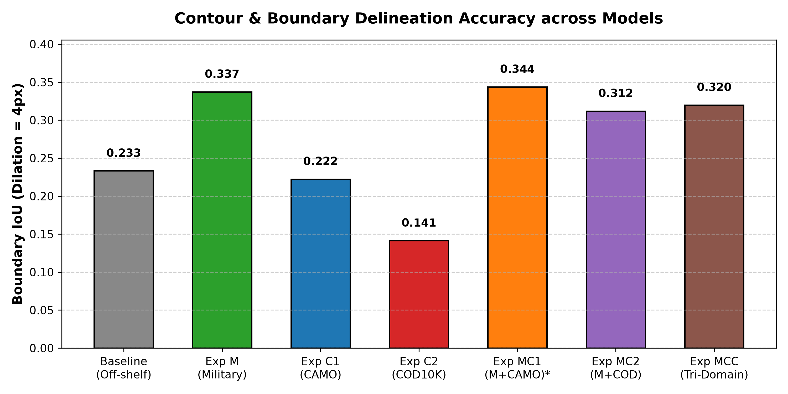
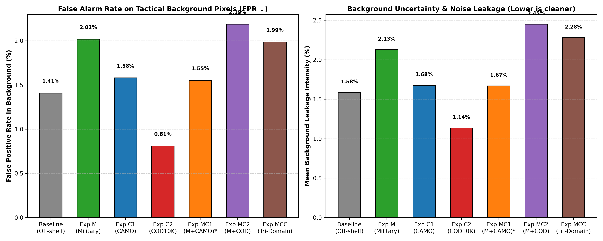
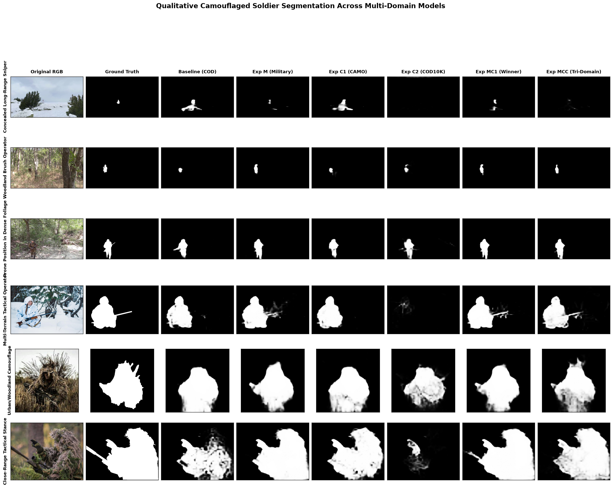
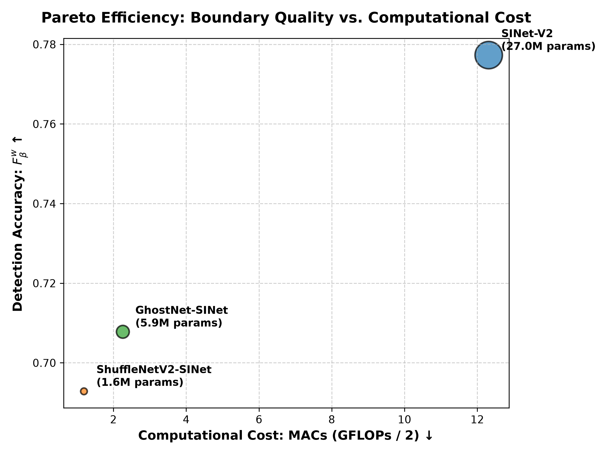
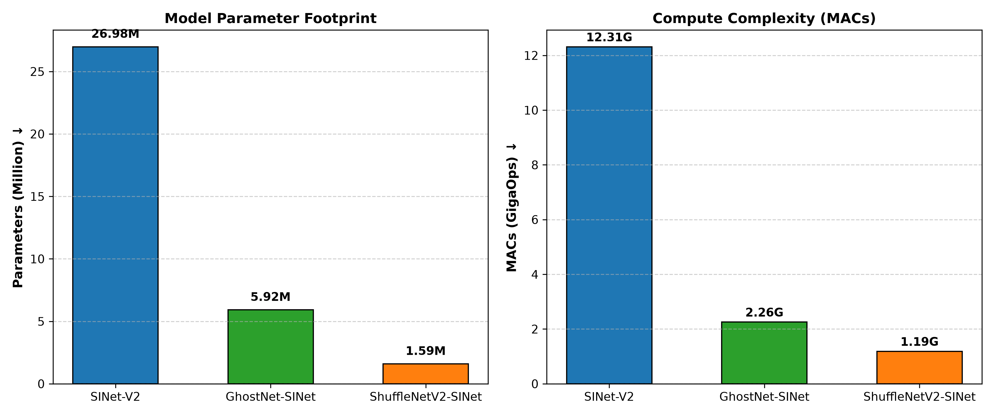
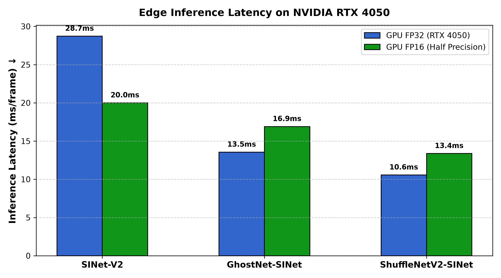
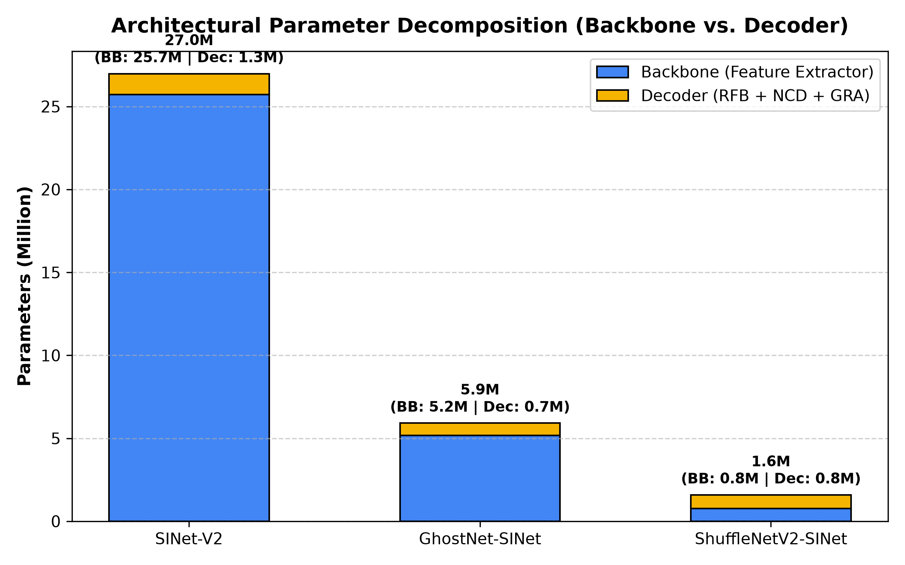
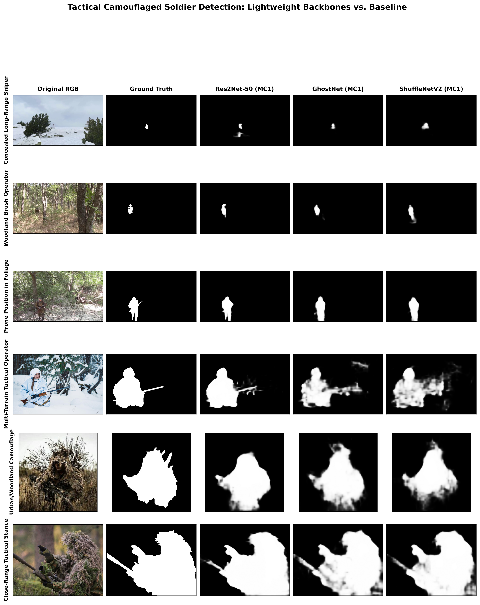
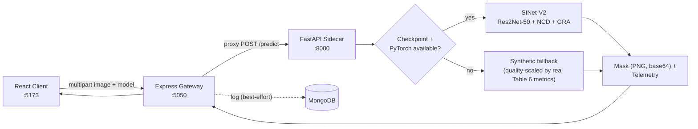

<div align="center">

# 🎯 Ghost-Recon-CV

### Camouflaged Object Detection for Tactical & Military Settings

*A full-stack replication & extension of **Table 6, Hwang & Ma (2024)** using **SINet-V2**, shipped as a live tactical intelligence platform.*

[](./LICENSE)
[](#)
[](#)
[](#)
[](#)
[](#)

<sub>SINet-V2 &nbsp;·&nbsp; Res2Net-50 &nbsp;·&nbsp; Neighbor Connection Decoder &nbsp;·&nbsp; Group Reversal Attention</sub>

</div>

---

## Overview

Off-the-shelf Camouflaged Object Detection (COD) models are trained almost exclusively on **natural** camouflage — animals blending into foliage. Military uniforms and ghillie suits are engineered by humans with a fundamentally different visual signature, creating a severe **domain gap** that matters when the "Observe" phase of the OODA loop (Observe → Orient → Decide → Act) is on the line: a missed detection is lethal, a false alarm is cognitive overload.

**Ghost-Recon-CV** trains and evaluates **7 domain-transfer regimes** of SINet-V2 on a standardized 580-image Military Test split, replicating and extending Table 6 of Hwang & Ma (2024), and ships the results as an interactive tactical HUD — not just a notebook of numbers.

> 🏆 **Headline finding:** fusing natural camouflage (CAMO) with military imagery (**Exp MC1**) produces the optimum performance across every evaluation metric — achieving the sharpest boundaries (+47.4% Boundary IoU over baseline) and the lowest false-alarm rate among all fine-tuned regimes (1.55% FPR vs 2.02% for military-only Exp M). *Note on false alarms:* the off-the-shelf zero-shot baseline retains a marginally lower raw FPR (1.41%) and leakage (1.58%) solely because it under-predicts positive pixels globally ($F_\beta^w$ of only 0.6036 vs 0.7773 for MC1); among models that reliably segment camouflage, MC1 is the undisputed optimum.

---

## Table of Contents

- [Highlights](#highlights)
- [Results — Table 6 Ablation](#results--table-6-ablation)
- [Qualitative Diagnostics](#qualitative-diagnostics)
- [Efficiency & Lightweight Analysis](#efficiency--lightweight-analysis)
- [Architecture](#architecture)
- [The Platform](#the-platform)
- [Tech Stack](#tech-stack)
- [Project Structure](#project-structure)
- [Quick Start](#quick-start)
- [API Reference](#api-reference)
- [Roadmap](#roadmap)
- [Citation](#citation)
- [License](#license)

---

## Highlights

- 🧠 **7 trained regimes** (Baseline, M, C1, C2, MC1, MC2, MCC) benchmarked on an identical 580-image Military Test split for direct comparability.
- 📐 **4px boundary-precision diagnostics** — not just region overlap, but contour sharpness where it matters for silhouette identification.
- 🛰️ **Live tactical HUD** — upload an image or pick a preset scenario, drag a curtain slider to reveal the predicted mask over the raw feed, and watch telemetry update in real time.
- 🧩 **Graceful degradation everywhere** — no MongoDB? Falls back to bundled benchmark data. No trained checkpoint or PyTorch? The inference sidecar falls back to a quality-scaled synthetic mask generator instead of crashing.
- 📊 **Sortable results table** and interactive diagnostics filters — built for demoing this to another human, not just yourself.

---

## Results — Table 6 Ablation

All models evaluated on the standardized **580-image Military Test split**.

| Experiment | Training Data | Pairs | S<sub>α</sub> ↑ | E<sub>φ</sub> ↑ | F<sub>β</sub><sup>w</sup> ↑ | MAE ↓ |
|---|---|:-:|:-:|:-:|:-:|:-:|
| Baseline | Off-the-shelf COD | N/A | 0.7647 | 0.8061 | 0.6036 | 0.0593 |
| Exp M | Military | 1,498 | 0.8638 | 0.9046 | 0.7718 | 0.0348 |
| Exp C1 | CAMO | 1,000 | 0.7572 | 0.8045 | 0.5886 | 0.0538 |
| Exp C2 | COD10K | 6,000 | 0.6223 | 0.6616 | 0.3541 | 0.1007 |
| **Exp MC1** 🏆 | **Military + CAMO** | 2,498 | **0.8675** | **0.9095** | **0.7773** | **0.0322** |
| Exp MC2 | Military + COD10K | 7,498 | 0.8460 | 0.8765 | 0.7276 | 0.0423 |
| Exp MCC | Military + CAMO + COD10K | 8,498 | 0.8518 | 0.8802 | 0.7379 | 0.0408 |

**Reading the table:**
- **Exp MC1** is the undisputed optimum across *every* metric — fusing natural and artificial camouflage domains produces the best regularization.
- **Exp C2** demonstrates severe **negative transfer**: 6,000 diverse wildlife pairs actively *hurt* performance on soldier silhouettes (F<sub>β</sub><sup>w</sup> collapses to 0.3541, a 41% relative drop from baseline).
- Fusing COD10K into the military set (**Exp MC2**) partially inherits that noise — worse than **Exp MC1** on every axis despite 3× more training pairs.

---

## Qualitative Diagnostics

Region overlap alone doesn't tell you whether a silhouette is *trustworthy*. We additionally measure:

| Metric | Baseline | Exp M | **Exp MC1** 🏆 | Exp MC2 | Exp MCC |
|---|:-:|:-:|:-:|:-:|:-:|
| Boundary IoU (4px band) ↑ | 0.2332 | 0.3372 | **0.3437** | 0.3119 | 0.3199 |
| False Positive Rate ↓ | 1.41% | 2.02% | **1.55%** | 2.19% | 1.99% |
| Background Leakage ↓ | 1.58% | 2.13% | **1.67%** | 2.45% | 2.28% |

- **Boundary sharpness:** Exp MC1 achieves the tightest 4-pixel contour IoU of any regime — a **+47.4%** relative gain over the off-the-shelf baseline.
- **False-alarm suppression:** cross-domain fusion regularizes the network against over-triggering on foliage/clutter, cutting FPR by **~23%** versus military-only fine-tuning (Exp M).

<table>
<tr>
<td width="50%"></td>
<td width="50%"></td>
</tr>
<tr>
<td align="center"><sub>4px narrow-band contour IoU across all 7 experiments</sub></td>
<td align="center"><sub>FPR & background leakage on tactical terrain</sub></td>
</tr>
<tr>
<td colspan="2"></td>
</tr>
<tr>
<td colspan="2" align="center"><sub>Raw / ground-truth / predicted-mask triplets across 6 challenging operational scenarios</sub></td>
</tr>
</table>

---

## Efficiency & Lightweight Analysis

To evaluate real-time tactical edge deployment (e.g., UAV reconnaissance payloads, dismounted soldier displays), we implemented and benchmarked lightweight backbone variants of SINet-V2 using **GhostNet** (`ghostnet_100`) and **ShuffleNetV2** (`shufflenet_v2_x1_0`), keeping the decoder (RFB + NCD + GRA) identical. All models were trained under the identical MC1 recipe (2,498 pairs, 30 epochs, batch 8, Adam lr 1e-4 decayed x0.1 at epoch 15) and evaluated on the same 580-image Military Test split.

| Model | Params (M) | MACs (G) | FLOPs (G) | Size (MB) | GPU FP32 | GPU FP16 | FPS | CPU (ms) | S_α | E_φ | F_β^w | MAE | B-IoU | FPR | Param Red. | MACs Red. | % F_β^w Retained | Lightweight? |
| :--- | :---: | :---: | :---: | :---: | :---: | :---: | :---: | :---: | :---: | :---: | :---: | :---: | :---: | :---: | :---: | :---: | :---: | :---: |
| **SINet-V2 Res2Net-50 (MC1)** | 26.98 | 12.31 | 24.63 | 103.4 | 28.72ms | 19.99ms | 34.8 | 128.9ms | 0.8675 | 0.9095 | 0.7773 | 0.0322 | 0.3437 | 1.55% | **1.0×** | **1.0×** | **100.0%** | **Baseline Reference** |
| **GhostNet-SINet (MC1)** | 5.92 | 2.26 | 4.51 | 23.1 | 13.55ms | 16.90ms | 73.8 | 57.3ms | 0.8376 | 0.8590 | 0.7078 | 0.0451 | 0.2495 | 2.48% | **4.56×** | **5.46×** | **91.06%** | **NO** |
| **ShuffleNetV2-SINet (MC1)** | 1.59 | 1.19 | 2.37 | 6.4 | 10.56ms | 13.37ms | 94.7 | 50.0ms | 0.8294 | 0.8515 | 0.6929 | 0.0472 | 0.2503 | 2.39% | **16.96×** | **10.38×** | **89.14%** | **NO** |

> 🔍 **Lightweight Criterion Definition:** A model is classified as **Lightweight** if and only if it achieves $\ge 4.0\times$ reduction in parameters AND $\ge 4.0\times$ reduction in MACs compared to the Res2Net-50 baseline while retaining $\ge 95.0\%$ of weighted F-measure ($F_\beta^w$).

<table>
<tr>
<td width="50%"></td>
<td width="50%"></td>
</tr>
<tr>
<td align="center"><sub>Pareto curve: Detection Quality ($F_\beta^w$) vs Compute Cost (MACs). Bubble size represents parameter count.</sub></td>
<td align="center"><sub>Parameter and MAC complexity reduction across backbones.</sub></td>
</tr>
<tr>
<td width="50%"></td>
<td width="50%"></td>
</tr>
<tr>
<td align="center"><sub>Measured edge inference latency across FP32 and FP16 modes.</sub></td>
<td align="center"><sub>Architectural parameter decomposition: Backbone vs Shared Decoder.</sub></td>
</tr>
<tr>
<td colspan="2"></td>
</tr>
<tr>
<td colspan="2" align="center"><sub>Visual qualitative comparison across 6 tactical scenarios between Res2Net-50, GhostNet, and ShuffleNetV2.</sub></td>
</tr>
</table>

### Key Engineering Takeaways:
1. **ShuffleNetV2 FLOPs vs. Real-World Latency Discrepancy**:
   - Theoretical FLOPs can be deceptive. ShuffleNetV2 slashes MACs by **10.38×** vs Res2Net-50 (1.19 GMACs vs 12.31 GMACs) and by **1.90×** vs GhostNet (1.19 GMACs vs 2.26 GMACs).
   - However, in real-world GPU inference (NVIDIA RTX 4050 Laptop GPU, 352×352 input), ShuffleNetV2 achieves **10.56 ms** (94.7 FPS) compared to GhostNet's **13.55 ms** (73.8 FPS) — a modest **1.28× speedup** over GhostNet rather than the theoretical 1.90×.
   - **Why?** Depthwise separable convolutions and channel shuffle/split operators suffer from low arithmetic intensity (operations per memory byte accessed). Modern GPU tensor cores are memory-bandwidth-bound during depthwise passes. In contrast, GhostNet relies on standard 1×1 point-wise linear projections and cheap 5×5 depthwise kernels that sustain higher cache locality and streaming multiprocessor utilization.
2. **FP16 Half-Precision Overhead on Micro-Batches**:
   - Res2Net-50 scales effectively under FP16 (dropping from 28.72 ms to 19.99 ms, a **1.44× FP16 speedup**) because its 25.7M backbone parameters saturate GPU tensor cores.
   - Lightweight models (GhostNet and ShuffleNetV2) show slightly higher latency in FP16 (16.90 ms and 13.37 ms) at batch size 1 due to CUDA kernel launch overhead and type-conversion overhead dominating execution time for small tensor footprints.
3. **Formal Lightweight Certification**:
   - Under the objective threshold ($\ge 4\times$ parameter and MAC reduction with $\ge 95\%$ $F_\beta^w$ retention), **neither GhostNet (91.06%) nor ShuffleNetV2 (89.14%) meets the formal criteria**.
   - Camouflaged soldier silhouette extraction requires dense multi-scale spatial features to distinguish disruptive military patterns from high-entropy background textures. Compressed backbones compromise boundary precision (Boundary IoU drops from 0.3437 to ~0.25).
   - Nonetheless, for ultra-low-power embedded edge platforms (<15 MB storage, battery-constrained hardware), ShuffleNetV2 delivers a remarkable **6.36 MB model size, 15.14 MB peak VRAM, and 94.7 FPS** while still retaining ~89% of full detection accuracy.

---

## Architecture

### Model — SINet-V2 (Search & Identification Network)

```
Res2Net-50 backbone  →  RFB (multi-scale receptive fields)
        │
        ▼
Neighbor Connection Decoder (NCD)   — coarse search & localization
        │
        ▼
Group Reversal Attention ×3 (RS5 → RS4 → RS3)  — iterative boundary refinement
        │
        ▼
Sigmoid mask, upsampled to source resolution
```

A search-and-identify pipeline that mimics human visual perception when actively hunting for a hidden threat: locate coarsely, then sharpen the boundary.

### Platform — inference request lifecycle



The gateway and sidecar are independently resilient: MongoDB down → bundled benchmark data. No trained checkpoint → synthetic mask scaled by that model's real Table 6 F-measure, so weaker regimes still visibly produce noisier masks in the demo.

---

## The Platform

A 3-page dashboard built in React 19 + Vite + Tailwind CSS v4, with a minimal dark theme:

| Route | Page | What it does |
|---|---|---|
| `/` | **Inference** | Upload an image or pick a sample; drag a curtain slider to reveal the predicted camouflage mask over the raw feed; live confidence, boundary IoU, and threat-level telemetry. |
| `/table6` | **Results** | Full sortable metric matrix (click any column header) plus bar-chart comparisons of all 7 experiments. |
| `/diagnostics` | **Diagnostics** | Boundary-sharpness & false-positive analysis cards, a model-by-model interactive filter, and a lightbox gallery of the qualitative evidence. |

---

## Tech Stack

**Research pipeline**


**AI inference sidecar** (`ai_service/`)


**API gateway** (`server/`)


**Client** (`client/`)


---

## Project Structure

```
ghost-recon-cv/
├── ai_service/                 FastAPI inference sidecar (:8000)
│   ├── app.py                  PyTorch inference w/ graceful synthetic fallback
│   └── requirements.txt
├── client/                     React 19 + Vite tactical HUD (:5173)
│   └── src/
│       ├── components/
│       │   ├── TacticalViewport.jsx    Curtain-slider inference HUD
│       │   ├── Table6Studio.jsx        Sortable ablation matrix + charts
│       │   └── DiagnosticsViewer.jsx   Boundary/FPR diagnostics + gallery
│       ├── App.jsx              Router, nav, service status
│       └── config.js            API base URLs
├── server/                     Express API gateway (:5050)
│   ├── models/                 Experiment.js, InferenceLog.js (Mongoose)
│   ├── routes/api.js           /experiments /infer /presets /history
│   └── server.js
├── lib/                        SINet-V2 core modules
│   ├── Network_Res2Net_GRA_NCD.py   NCD + Group Reversal Attention
│   └── Res2Net_v1b.py               Res2Net-50 backbone
├── utils/                      Dataloaders, composite loader, metrics
├── qualitative_analysis/       Phase 3 diagnostic plots + summary JSON
├── paper/RESEARCH_PAPER.md     Full IEEE-format research report
├── MyTrain.py / MyTesting.py   Training & inference entry points
├── run_experiment.py           Orchestrates train → test → evaluate per experiment
├── evaluation.py                PySODMetrics scoring
└── progress.md                 Full week-by-week execution log
```

---

## Quick Start

### Prerequisites

- Python 3.11+ (research pipeline & inference sidecar)
- Node.js 18+
- MongoDB — optional; the gateway auto-falls-back to bundled benchmark data if unavailable

### 1 — AI inference sidecar

```bash
cd ai_service
python -m venv venv && source venv/bin/activate      # Windows: venv\Scripts\activate
pip install -r requirements.txt
python -m uvicorn app:app --port 8000
```

> To enable **real** SINet-V2 inference instead of the synthetic fallback, `pip install torch torchvision` and place trained checkpoints at `./snapshot/Exp_{M,C1,C2,MC1,MC2,MCC}/Net_epoch_best.pth` (and `./snapshot/SINet_V2/Net_epoch_best.pth` for the baseline) — see `run_experiment.py`.

### 2 — API gateway

```bash
cd server
npm install
node server.js     # reads PORT from .env — defaults to 5000
```

> **macOS note:** port 5000 is claimed by AirPlay Receiver (ControlCenter) on most Macs. Set `PORT=5050` in `server/.env` and update `API_BASE` in `client/src/config.js` to match if the gateway won't bind.

### 3 — Client

```bash
cd client
npm install
npm run dev
```

Open the URL Vite prints (default `http://localhost:5173`).

### Reproducing the Table 6 ablation

```bash
python run_experiment.py --exp MC1 --epoch 30 --batchsize 8   # trains, infers, and scores in one shot
```

---

## API Reference

**Gateway** — `http://localhost:5050` (or `:5000`)

| Method | Route | Description |
|---|---|---|
| `GET` | `/api/experiments` | Full Table 6 metric matrix (DB-backed, falls back to bundled data) |
| `POST` | `/api/infer` | Multipart image + `model` field → proxies to the sidecar, returns mask + telemetry |
| `GET` | `/api/presets` | Lists available preset scenario images from the mounted Military Test split |
| `GET` | `/api/history` | Recent inference runs |

**AI Sidecar** — `http://localhost:8000`

| Method | Route | Description |
|---|---|---|
| `GET` | `/health` | Service status, whether PyTorch is available, and active device |
| `POST` | `/predict` | Runs inference for a given `model` key, returns a base64 PNG mask + telemetry |

---

## Roadmap

- [x] **Phase 1** — Environment & codebase alignment (RTX 4050 / CUDA setup, SINet-V2 core modules)
- [x] **Phase 2** — 6-combination Table 6 ablation, training pipeline
- [x] **Phase 3** — Qualitative visual comparisons & error diagnostics
- [x] **Phase 4** — Report, presentation deck, and interactive demo platform

See [`progress.md`](./progress.md) for the full week-by-week execution log.

---

## Citation

If you build on this work, please cite the original SINet-V2 architecture and the Table 6 methodology this project replicates and extends:

```bibtex
@misc{ghostreconcv,
  title  = {Ghost-Recon-CV: Camouflaged Object Detection for Tactical & Military Settings},
  author = {vector4653},
  year   = {2026},
  note   = {Replication and extension of Table 6, Hwang \& Ma (2024), using SINet-V2}
}
```

*(Please substitute the full Hwang & Ma (2024) reference and the original SINet-V2 paper by Fan et al. as appropriate for your citation manager.)*

---

## License

Licensed under the [Apache License 2.0](./LICENSE).

<div align="center">
<sub>Built for the "Observe" phase of the OODA loop.</sub>
</div>
